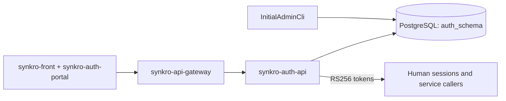

# synkro-auth-api

> Identity service for human sessions, administrative user management, service tokens and initial administrator setup.

Part of the **SynkroTech SAS Sales Management System**. Architecture, decisions and
contracts live in [synkro-docs](https://github.com/code-corhuila/synkro-docs).

**Quick start:** from this repository root, configure Auth's database and signing key, then use `mvn -pl auth-app spring-boot:run` after installing the modules. See [Getting started](#getting-started).

## What it does

- Authenticates users and issues locally verifiable RS256 access tokens.
- Rotates refresh tokens, detects reuse and supports logout.
- Lets ADMIN register, search and inspect users and reset an active non-ADMIN user's password.
- Issues service tokens and initializes the first administrator through InitialAdminCli.
- Persists only Auth data in `auth_schema`; infrastructure owns the PostgreSQL instance.

## Where it fits



Auth alone mounts the private signing key. Other services verify signatures locally with its public key; the gateway's credential-presence check does not replace verification.

## Tech stack

| Component | Choice |
|---|---|
| Language / framework | Java 21; Spring Boot 3.5.0 |
| Build | Maven modules: auth-core, auth-adapters, auth-app, auth-coverage |
| Persistence | JDBC; PostgreSQL 16 as auth_app |
| Runtime | Docker image; internal HTTP 8080 |

## Dependencies

| Depends on | Purpose | Configuration |
|---|---|---|
| synkro-auth-db | Auth schema, migrations and grants | Apply migrations before startup |
| PostgreSQL | Sessions, users, audit and token metadata | SPRING_DATASOURCE_* |
| RSA signing key | RS256 token issuance | JWT_PRIVATE_KEY_FILE; protected file |
| synkro-api-gateway | Public HTTP entry point | platform network |

## Getting started

From the repository root, use **PowerShell or Bash** with Java 21, Maven, the migrated Auth schema, `auth_app` credentials and a protected signing-key file already configured.

```text
mvn install -DskipTests
mvn -pl auth-app spring-boot:run
```

The first command installs the reactor modules locally. A new environment has no human user: follow the [initial administrator procedure](docs/initial-administrator.md) before login. Never put a password in command arguments.

For the complete platform, start from [synkro-infra-postgres](https://github.com/code-corhuila/synkro-infra-postgres).

## Configuration

The committed [.env.example](.env.example) is the configuration inventory.
Its values are examples; required inputs and defaults follow its comments and the
owning implementation. Keep real secrets in protected local files.

| Variable | Purpose |
|---|---|
| `JWT_PRIVATE_KEY_FILE` | Identity key input; keep private material outside Git |
| `SPRING_DATASOURCE_URL` | Connection address, origin or build-time entry point |
| `SPRING_DATASOURCE_USERNAME` | Connection or administrator identity |

Password-file and inline-password alternatives follow the implementation's exclusive-source rules. Container Compose inputs such as AUTH_APP_PASSWORD_PATH and JWT_PRIVATE_KEY_PATH are documented by deploy/compose.yml; they become file paths inside the container.

## Interface

| Operation | Access / result |
|---|---|
| POST /api/v1/auth/login; POST /refresh | Public credential / refresh flows |
| POST /api/v1/auth/logout | Authenticated human; ends renewable session |
| POST /api/v1/auth/register | ADMIN; idempotent user registration |
| GET /api/v1/auth/users/{id}; POST /users/search | ADMIN; user lookup and search |
| POST /api/v1/auth/users/{id}/password-reset | ADMIN; active non-ADMIN target; audited and replay-safe |
| POST /api/v1/auth/service-tokens; GET /service-tokens/{id} | ADMIN; token shown only on creation |
| GET /health | Public; 200 or database-aware 503 |

All abbreviated paths above share `/api/v1/auth`. See the [Auth OpenAPI contract](https://github.com/code-corhuila/synkro-docs/blob/main/07-api/contracts/openapi/synkro-auth-api.yaml).

## Project structure

```text
auth-core/       domain, use cases and ports
auth-adapters/   HTTP/security and JDBC adapters
auth-app/        Spring composition and InitialAdminCli
auth-coverage/   aggregate coverage checks
deploy/          Docker service and secret mounts
docs/            operational details and delivery evidence
```

## Testing

```text
mvn test
mvn -B verify
```

Unit/HTTP tests use controlled collaborators; database integration requires explicit TEST_* inputs and a disposable migrated database. Initial-administrator integration tests can clear their fixture schema: use only their explicitly marked disposable target. Detailed commands remain in the testing guide below.

## Branching and contributing

Use a `feat/`, `fix/` or `chore/` child branch and a PR into `develop`.
Permanent branches are `develop`, `qa` and `main`; none accepts direct commits.
Promote through a `qa-<description>` or release child with `git cherry-pick -x`.
`main` requires approval from `ariel5253`. Use English Conventional Commits.
See [Git conventions](https://github.com/code-corhuila/synkro-docs/blob/main/00-governance/git-conventions.md).

## Further documentation

- [Local development](docs/local-development.md).
- [Testing](docs/testing.md).
- [Initial administrator](docs/initial-administrator.md).
- [Users](docs/users.md).
- [Sessions and tokens](docs/sessions-and-tokens.md).
- [Domain rules](https://github.com/code-corhuila/synkro-docs/blob/main/02-domain/entities-and-rules.md), [contracts](https://github.com/code-corhuila/synkro-docs/tree/main/07-api/contracts/openapi) and [testing strategy](https://github.com/code-corhuila/synkro-docs/blob/main/11-quality/testing-strategy.md).

<!-- Preserve previously published README section links. -->
<a id="branching"></a>
<a id="running-locally"></a>
<a id="running-the-tests"></a>
<a id="development"></a>
<a id="signing-key"></a>
<a id="database"></a>
<a id="the-first-local-user"></a>
<a id="initial-administrator"></a>
<a id="who-may-run-it-and-when"></a>
<a id="run-it"></a>
<a id="outcomes-and-exit-codes"></a>
<a id="what-the-transaction-does"></a>
<a id="if-it-fails-or-you-are-not-sure"></a>
<a id="after-the-first-run"></a>
<a id="limits"></a>
<a id="users-register-and-lookup"></a>
<a id="users-password-reset-by-an-admin"></a>
<a id="sessions-logout-and-refresh-token-reuse"></a>
<a id="service-tokens"></a>
<a id="token-validation"></a>


## Gateway registration security regression

[Security issue #280 acceptance map](docs/gateway-registration-security.md) reuses the real Gateway/Auth/PostgreSQL fixture and verifies forbidden ADMIN registration/replay without successful writes. The dedicated CI job runs that same script.

## Login security extension

See [account login protection](docs/login-account-protection.md) and [concurrent login admission](docs/login-concurrency.md). Both controls apply. Auth rejects blocked login attempts with the common `429 TOO_MANY_REQUESTS` envelope and `Retry-After`; Auth-generated responses use `Cache-Control: no-store`. QA/main promotion and deployment are separate steps.
